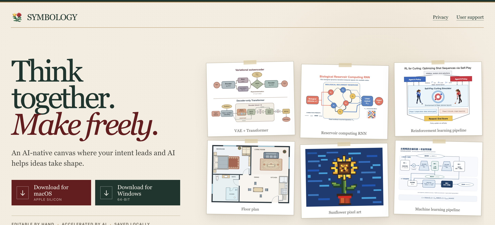

# Symbology

**Think together. Make freely.**

[Symbology](https://symbology.onrender.com/) is an AI-native, local-first canvas where your intent leads and AI helps your ideas take shape. Create and refine diagrams, technical figures, floor plans, pixel art, and other visual work on an open canvas—editable by hand, accelerated by AI, and saved locally.

This repository hosts the official desktop releases for macOS and Windows. To learn more about the product and see examples made with Symbology, visit **[symbology.onrender.com](https://symbology.onrender.com/)**.



## Download

The latest release is **Symbology 0.1.5**.

| Platform | System | Download |
| --- | --- | --- |
| macOS | Apple silicon (M1 or newer), macOS 12+ | [Download `.dmg`](https://github.com/hantaoZhangrichard/symbology-downloads/releases/download/v0.1.5/Symbology-0.1.5-arm64.dmg) |
| Windows | 64-bit Windows | [Download `.exe`](https://github.com/hantaoZhangrichard/symbology-downloads/releases/download/v0.1.5/Symbology-Setup-0.1.5-x64.exe) |

You can also browse the [latest release and all available files](https://github.com/hantaoZhangrichard/symbology-downloads/releases/latest).

## Install

### macOS

1. Download and open the `.dmg` file.
2. Drag **Symbology** into the **Applications** folder.
3. Open Symbology from Applications.

### Windows

1. Download the `.exe` installer.
2. Run the installer and follow the on-screen instructions.
3. Launch Symbology from the Start menu or desktop shortcut.

## Verify your download

Use the SHA-256 checksum for your installer to verify that the download is complete and unmodified.

| File | SHA-256 |
| --- | --- |
| `Symbology-0.1.5-arm64.dmg` | `5b93a22055b795a606b0dfeb071b84c3d8ed0d427bf67639248208aa9e845c4b` |
| `Symbology-Setup-0.1.5-x64.exe` | `b708314fc98d5451e71dcae1d5c571e830f81c1a49d8c0efed8058b0761fd0a7` |

On macOS:

```sh
shasum -a 256 Symbology-0.1.5-arm64.dmg
```

On Windows PowerShell:

```powershell
Get-FileHash .\Symbology-Setup-0.1.5-x64.exe -Algorithm SHA256
```

The value printed by the command should match the corresponding checksum above.

## Links

- [Symbology website](https://symbology.onrender.com/)
- [Releases](https://github.com/hantaoZhangrichard/symbology-downloads/releases)
- [User support](https://tally.so/r/J9PAvz)
- [Privacy policy](https://symbology-privacy.vercel.app/)
